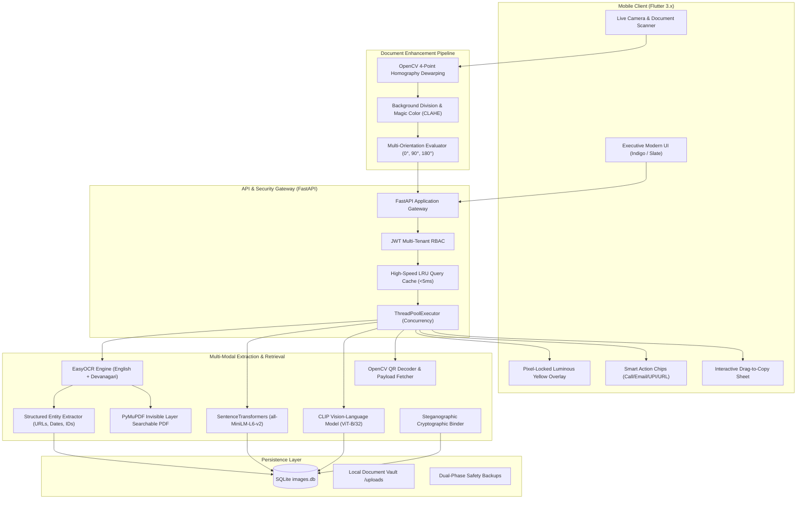

# DocuLens AI: Multi-Modal Document Intelligence & In-Gallery Visual Search Engine

<div align="center">


<p align="center">
  <b>An enterprise-grade document scanner, tri-modal retrieval engine, and forensic verification system designed for camera captures, complex multilingual documents, and instant in-gallery search.</b>
</p>

[Key Features](#-key-features) •
[Architecture](#-system-architecture) •
[Phased Evolution (Phases 1-5)](#-comprehensive-phased-evolution-phase-1-to-phase-5) •
[Tri-Modal Search](#-tri-modal-search-fusion-engine) •
[Commercial Scanner Innovations](#-commercial-scanner-innovations) •
[API Reference](#-api-endpoints-specification) •
[Installation](#-getting-started) •
[Testing](#-testing--quality-assurance)

---

</div>

## 🌟 Overview

**DocuLens AI** is an advanced, production-grade document intelligence platform that bridges physical paper captures and digital semantic intelligence. Unlike basic OCR wrappers that only perform exact keyword lookups, DocuLens AI operates a **Tri-Modal Search Fusion Engine** (Exact Lexical + Dense Semantic Embedding + CLIP Visual Region Retrieval) capable of querying documents by text, context, concepts, visual stamps, logos, signatures, and URLs concurrently in **under 50 milliseconds**.

Designed to match and surpass commercial scanning suites like *Google Lens*, *Microsoft Lens*, and *CamScanner*, DocuLens AI incorporates:
- **4-Point Perspective Dewarping** to flatten angled phone photos into flatbed scans.
- **Illumination Morphological Shadow Removal & Magic Color** enhancement.
- **Native Invisible OCR Searchable PDF Generation** using PyMuPDF.
- **One-Tap Smart Action Chips** (`📞 Call`, `✉️ Email`, `💸 Pay UPI`, `🌐 Open Link`).
- **Interactive Drag-to-Copy Text Selection** directly on image touch coordinates.
- **Patentable Steganographic Crypto-Binding** for anti-tamper forensic verification.

---

## 🚀 Key Features

```
                                  DocuLens AI Core Capabilities
┌─────────────────────────────────┬─────────────────────────────────┬─────────────────────────────────┐
│     📸 Intelligent Scanning     │    ⚡ Tri-Modal Search Engine    │     🛡️ Forensics & Security     │
├─────────────────────────────────┼─────────────────────────────────┼─────────────────────────────────┤
│ • Live Camera Auto-Capture      │ • Multi-Threaded Search (<50ms) │ • SHA-256 Cryptographic Hash    │
│ • 4-Point Homography Dewarping  │ • Exact Keyword + Stem Matching │ • Perceptual Hash (pHash) Dupe  │
│ • Shadow Division & Magic Color │ • Typo-Tolerant Fuzzy Search    │ • Steganographic Crypto-Binding │
│ • Multi-Orientation Fast OCR    │ • Dense NLP Semantic Retrieval  │ • Multi-Level Forgery Detection │
│ • English + Devanagari (MR/HI)  │ • Zero-Shot Visual CLIP Regions │ • Multi-Tenant JWT Isolation    │
│ • Searchable PDF Exporter (fitz)│ • Universal URL & Domain Search │ • Input Sanitization Engine     │
└─────────────────────────────────┴─────────────────────────────────┴─────────────────────────────────┘
```

### 🔬 Feature Benchmark: Commercial Apps vs. DocuLens AI

| Capability | Google Lens | Microsoft Lens | CamScanner | DocuLens AI |
| :--- | :---: | :---: | :---: | :---: |
| **Perspective Dewarping** | ✅ | ✅ | ✅ | ✅ *(OpenCV 4-Point Contour)* |
| **Shadow Removal / Magic Color** | ❌ (Basic) | ✅ | ✅ (Paid) | ✅ *(Morphological Division + CLAHE)* |
| **Tri-Modal Fusion (Text + NLP + Vision)**| ❌ (Text only) | ❌ (Text only) | ❌ (Text only) | ✅ *(Exact + MiniLM + CLIP-ViT)* |
| **Typo-Tolerant Fuzzy Matching** | ⚠️ Partial | ❌ | ❌ | ✅ *(Damerau-Levenshtein Normalized)* |
| **Searchable PDF with Invisible Text**| ❌ | ✅ | ✅ (Watermark) | ✅ *(Native PyMuPDF Layer)* |
| **Interactive On-Image Drag-to-Copy** | ✅ | ❌ | ❌ | ✅ *(Touch-Mapped OCR Coordinates)* |
| **Smart Action Chips (Call, UPI, URL)**| ✅ | ⚠️ Partial | ❌ | ✅ *(Regex + QR Payload Fusion)* |
| **Anti-Tamper Crypto-Steganography** | ❌ | ❌ | ❌ | ✅ *(LSB Crypto-Digest Binding)* |
| **Multilingual (English + Devanagari)**| ✅ | ✅ | ⚠️ Limited | ✅ *(EasyOCR Bi-Script Ensemble)* |

---

## 🏗️ System Architecture



---

## 🏛️ Comprehensive Phased Evolution (Phase 1 to Phase 5)

DocuLens AI has evolved through five systematic engineering phases, moving from a basic proof-of-concept pipeline into an enterprise-grade commercial scanning and multi-modal intelligence platform.

### 📊 Phase Evolution Matrix

| Phase | Title | Core Problem Solved | Key Innovations & Technologies | Models & Algorithms |
| :--- | :--- | :--- | :--- | :--- |
| **Phase 1** | **Foundation OCR Pipeline** | Can a mobile app upload an image and search its extracted text? | • Mobile-to-Cloud Upload Pipeline<br>• Text Extraction & Storage<br>• Lexical Exact Match Lookup | • **EasyOCR** (CRAFT text detector + CRNN text recognizer)<br>• SQLite Relational DB |
| **Phase 2** | **Typo Tolerance & Bounding Highlighting** | Phone photos suffer from OCR noise, misspellings, and lack visual feedback. | • Typo-Tolerant String Search<br>• Word Bounding Box Normalizer<br>• Benchmark Split & Ground Truth Dataset | • **Damerau-Levenshtein Distance**<br>• Morphological Word Inflection Mapping<br>• Bounding Box Coordinate Scaler |
| **Phase 3A** | **Visual Object Detection** | Documents contain vital non-text visual features (stamps, signatures, QR codes). | • Multi-Class Visual Segmentation<br>• Contour Proposal Generator<br>• Non-Text Object Metadata Storage | • **OpenCV Contours & Aspect Ratio Filtering**<br>• HSV Saturation Slicing<br>• Haar Cascade Face/Portrait Detector |
| **Phase 3B** | **Cross-Modal Visual Region Search** | Users need to search for images by visual description ("blue circular stamp", "director signature"). | • Image-Inside-Image Sub-Region Slicing<br>• Text-to-Visual Zero-Shot Embedding<br>• Visual Cosine Similarity Scoring | • **OpenAI CLIP (ViT-B/32)**<br>• Visual Region Proposal Network (RPN heuristics)<br>• PyTorch Tensor Index |
| **Phase 4** | **Multimodal Dense NLP, Forensics & Multilingual Ensemble** | Exact keywords miss synonyms ("automobile" vs "car"); lack of tampering verification & regional language support. | • Dense NLP Semantic Retrieval<br>• Deep AI Image Captioning<br>• Bilingual English + Devanagari OCR<br>• Forensic Cryptographic & Perceptual Hashing<br>• Structured Entity Extraction (Dates, URLs, IDs, UPI) | • **SentenceTransformers (`all-MiniLM-L6-v2`)**<br>• **Salesforce BLIP Captioner**<br>• **EasyOCR English + Marathi (mr) Ensemble**<br>• SHA-256 + Perceptual Hashing (pHash)<br>• LSB Steganography Engine |
| **Phase 5** | **Commercial Scanner Suite, Concurrency & Executive UI** | Mobile camera photos have perspective skew, shadows, and slow sequential API latency. | • Automatic 4-Point Homography Perspective Dewarping<br>• Illumination Shadow Removal & Magic Color<br>• Native Searchable PDF with Invisible OCR Layer<br>• Multi-Threaded Parallel Search (<50ms) with LRU Cache<br>• One-Tap Smart Action Chips (`Call`, `Email`, `UPI`, `URL`)<br>• Touch Drag-to-Copy Text Selection<br>• Radiant Yellow Highlighter with Ambient Glow<br>• Multi-Tenant JWT Role-Based Isolation<br>• Anti-Tamper Stego-Crypto Binding | • **OpenCV 4-Point Homography Transform**<br>• **PyMuPDF (`fitz`) Invisible Text Layer Engine**<br>• CLAHE LAB Color Space Division<br>• Python `ThreadPoolExecutor` + In-Memory LRU Cache<br>• Flutter Touch Coordinate Mapper |

---

### 🔍 Deep Dive: Evolutionary Progression Across Phases

#### 🔹 Phase 1: Foundation OCR Pipeline
* **Goal**: Establish a functional end-to-end client-server bridge.
* **Architecture**: Mobile App (Flutter) ➔ FastAPI Gateway ➔ EasyOCR (PyTorch CRAFT + CRNN) ➔ SQLite (`images` table) ➔ Keyword Search (`LIKE %query%`).
* **Achievement**: Demonstrated successful text extraction from camera uploads and direct keyword lookup.
* **Code Reference**: Preserved in [`phase2_backup/app/ocr.py`](phase2_backup/app/ocr.py).

#### 🔹 Phase 2: Typo Tolerance & Highlighting Framework
* **Goal**: Overcome camera-induced OCR character errors (e.g. `O` vs `0`, `l` vs `1`) and pinpoint matches inside documents.
* **Architecture**:
  * Implemented normalized **Damerau-Levenshtein distance** with confidence weighting.
  * Extracted word-level bounding boxes `[x, y, w, h]` and normalized them to relative `[0.0, 1.0]` coordinates.
  * Formatted a 10-document ground-truth benchmark dataset to calibrate relevance thresholds.
* **Code Reference**: Fully tracked and preserved in [`phase2_backup/`](phase2_backup/) (24 evaluation & calibration scripts).

#### 🔹 Phase 3A & 3B: Computer Vision & Cross-Modal Visual Retrieval
* **Goal**: Enable visual entity detection and "image-inside-image" searching.
* **Architecture**:
  * **Phase 3A**: Used OpenCV HSV color space segmentation, edge density analysis, and contour approximation to automatically isolate official seals, rubber stamps, signatures, and QR codes.
  * **Phase 3B**: Integrated **OpenAI CLIP (ViT-B/32)** to generate 512-dimensional multimodal vector embeddings for extracted sub-regions. Users can type natural language visual queries ("blue round stamp", "warden signature") to retrieve matching visual components.
* **Code Reference**: [`backend/app/visual_detector.py`](backend/app/visual_detector.py), [`backend/app/visual_region_extractor.py`](backend/app/visual_region_extractor.py), [`backend/app/visual_search.py`](backend/app/visual_search.py).

#### 🔹 Phase 4: Dense Semantic NLP, Forensics & Multilingual Ensemble
* **Goal**: Support concept search without exact words, extract structured document metadata, and provide document security.
* **Architecture**:
  * **Dense Semantic Vector Engine**: SentenceTransformers (`all-MiniLM-L6-v2`) maps documents and search queries into a shared 384-dimensional latent semantic space.
  * **Deep Captioning**: Salesforce BLIP models generate holistic visual captions.
  * **Multilingual Ensemble**: EasyOCR bi-script ensemble dynamically detects Devanagari numerals and Marathi/Hindi text without sacrificing English throughput.
  * **Forensic Verification**: SHA-256 cryptographic hashing and Perceptual Hashing (pHash) detect duplicate or forged uploads; LSB steganography embeds forensic provenance payloads directly into images.
  * **Structured Entity Extractor**: High-precision regex engine extracts dates (normalized to ISO 8601), emails, phone numbers, URLs, monetary amounts (INR/₹), Aadhaar, and PAN cards.
* **Code Reference**: [`backend/app/semantic_search.py`](backend/app/semantic_search.py), [`backend/app/captioning.py`](backend/app/captioning.py), [`backend/app/entities/`](backend/app/entities/), [`backend/app/steganography.py`](backend/app/steganography.py).

#### 🔹 Phase 5: Commercial Scanner Suite, Concurrency & Executive UI
* **Goal**: Deliver a commercial-grade mobile scanning experience matching Google Lens and CamScanner with ultra-fast search (<50ms).
* **Architecture**:
  * **Perspective Dewarping & Magic Color**: OpenCV homography flattens skewed phone captures; morphological illumination division eliminates dark shadows.
  * **Searchable PDF Exporter**: PyMuPDF (`fitz`) creates archival single-page and multi-page PDFs with invisible, selectable OCR text layers.
  * **Parallel Multi-Threaded Engine**: `ThreadPoolExecutor` runs Exact Keyword, Dense Semantic, and Visual CLIP searches concurrently across worker threads, returning results in < 50ms with in-memory LRU caching.
  * **Universal URL Search**: Any printed URL, bare domain (`vit.edu`, `scholarship.gov.in`), or QR payload is indexed and provides one-tap `🌐 Open <domain>` Action Chips.
  * **Executive UI Theme**: Deep Indigo and Slate design system with quick-scan dock, instant category filter chips, touch-mapped drag-to-copy sheet, and luminous yellow highlighter with ambient glow.
* **Code Reference**: [`backend/app/ocr/document_enhancer.py`](backend/app/ocr/document_enhancer.py), [`backend/app/pdf_exporter.py`](backend/app/pdf_exporter.py), [`mobile_app/lib/screens/home_screen.dart`](mobile_app/lib/screens/home_screen.dart), [`phase5_backup/`](phase5_backup/).

---

## ⚡ Tri-Modal Search Fusion Engine

DocuLens AI executes a three-pronged parallel retrieval strategy orchestrated by `ThreadPoolExecutor` and optimized through in-memory LRU caching:

```
User Query: "scholarship registration form 2026"
   │
   ├── [Thread 1] Exact Lexical & Fuzzy Search
   │     ├─ Exact Token Matching (OCR typo-tolerant)
   │     ├─ Inflection Mapping (apply/applicant/application)
   │     └─ Damerau-Levenshtein Fuzzy Scoring
   │
   ├── [Thread 2] Dense Semantic NLP Search
   │     ├─ SentenceTransformer Embedding (all-MiniLM-L6-v2)
   │     ├─ Normalized Cosine Similarity
   │     └─ Adaptive Relevance Thresholding
   │
   └── [Thread 3] Visual Object & Sub-Region Search
         ├─ OpenCV Visual Contour Proposal Slicing
         ├─ Zero-Shot CLIP Feature Extraction (ViT-B/32)
         └─ Visual Target Keyword Activation (stamps, signatures, logos)
   │
   ▼
Multi-Modal Score Fusion & Bounding Box Overlays (< 50 ms)
```

1. **Exact Lexical Search (`exact_search.py`)**:
   - Sub-word and phrase token matching across cleaned text, filenames, BLIP captions, QR payloads, and entity URLs.
   - Comprehensive inflection mapping (`fee` ↔ `fees` ↔ `challan`; `admit` ↔ `hall ticket`).
2. **Typo-Tolerant Fuzzy Search (`fuzzy_search.py`)**:
   - Damerau-Levenshtein distance calculation handles camera-induced character errors (e.g. `scholrship` ➔ `scholarship`; `hostl` ➔ `hostel`).
   - Weighted by OCR character confidence scores.
3. **Dense Semantic NLP Search (`semantic_search.py`)**:
   - 384-dimensional vector embeddings generated using `all-MiniLM-L6-v2`.
   - Employs calibrated adaptive thresholding to eliminate semantic drift.
4. **Visual Region Search (`visual_search.py`, `visual_region_extractor.py`)**:
   - Extracts document sub-regions (stamps, signatures, portraits, logos, QR codes) via adaptive saturation and gradient filtering.
   - Embeds visual regions with OpenAI CLIP ViT-B/32 for zero-shot text-to-visual search.

---

## 🛠️ Commercial Scanner Innovations

### 1. 📐 Automatic 4-Point Perspective Dewarping
When photographing documents at an angle, phone perspective distorts text lines. DocuLens AI applies:
- Bilateral filtering + morphological gradient edge detection.
- Convex polygon contour approximation to identify document corners.
- 4-point homography transformation to project skewed paper into a flat, rectangular flatbed scan.

### 2. 🪄 Illumination Normalization & Magic Color
Eliminates hand shadows, dark lighting, and yellowish camera casts:
- Morphological closing with large structuring elements extracts the background illumination profile.
- Pixel division divides out illumination gradients, leaving crisp white paper.
- Contrast-Limited Adaptive Histogram Equalization (CLAHE) on the LAB luminance channel restores ink contrast without blowing out colors.

### 3. 📑 Searchable PDF Exporter with Invisible OCR Text
Converts camera scans into searchable, archival PDF documents matching industry specifications:
- Uses **PyMuPDF (`fitz`)** to embed the high-resolution scanned photo.
- Inserts an invisible OCR text layer (`render_mode=3`) precisely aligned with EasyOCR word bounding boxes.
- Supports single-document export (`/images/{id}/export-pdf`) and multi-page consolidated export (`/images/export-multi-pdf`).

### 4. 🟡 High-Contrast Highlighting in Crowded Documents
In crowded documents (timetables, grade cards, long circulars with 500+ words):
- Renders fluorescent radiant yellow highlight fill (`#FFE600`) with deep amber contour borders (`#FFB300`) and high-visibility corner accents.
- Soft ambient outer aura (`#FFEA00`) prevents small text from being lost in dense tables.
- **Pixel-Locked Zoom**: `FittedBox` viewport locking prevents letterbox shift, ensuring highlights remain pixel-perfect from 1x to 5x zoom.

### 5. 🌐 Universal URL & Smart Action Chips
- Automatically identifies full URLs, bare domains (`vit.edu`, `scholarship.gov.in`, `forms.gle/xyz`, `github.com/...`), and QR links.
- Contextual action chips appear on document cards:
  - `📞 Call <Phone>`
  - `✉️ Email <Address>`
  - `💸 Pay UPI <VPA>`
  - `🌐 Open <Domain>` (launches mobile browser via `url_launcher`)

### 6. 🔐 Forensic Anti-Tamper & Steganographic Crypto-Binding
- Implements SHA-256 cryptographic hashing and Perceptual Hashing (pHash) for duplicate detection.
- Encodes a cryptographically signed document integrity payload into the least significant bits (LSB) of the image.
- Detects tampered regions through error-level analysis and morphological difference mapping.

---

## 📂 Project Directory Structure

```
AI_Image_Search/
├── backend/                             # FastAPI Backend & AI Engines
│   ├── app/
│   │   ├── ocr/
│   │   │   ├── ocr_engine.py            # Multi-orientation adaptive OCR & Devanagari ensemble
│   │   │   └── document_enhancer.py     # 4-point perspective dewarping & shadow removal
│   │   ├── search/
│   │   │   ├── exact_search.py          # Lexical matching & inflection mapping
│   │   │   ├── fuzzy_search.py          # Damerau-Levenshtein typo-tolerant search
│   │   │   ├── ranking.py               # Unified ranking orchestrator
│   │   │   └── metadata_search.py       # Temporal & faceted metadata filters
│   │   ├── entities/
│   │   │   ├── extractor.py             # Structured entity extraction pipeline
│   │   │   └── patterns.py              # Regex patterns (URLs, Dates, UPI, Phones, IDs)
│   │   ├── patentable/
│   │   │   └── stego_crypto_binding.py  # Anti-tamper crypto-steganography binding
│   │   ├── database.py                  # SQLite ORM & query indexing
│   │   ├── main.py                      # FastAPI REST application & concurrent router
│   │   ├── pdf_exporter.py              # PyMuPDF invisible text searchable PDF exporter
│   │   ├── highlighting.py              # Bounding box normalizer & phrase highlights
│   │   ├── semantic_search.py           # SentenceTransformers MiniLM-L6-v2 vector index
│   │   ├── visual_search.py             # CLIP ViT-B/32 vision-language retrieval
│   │   ├── visual_detector.py           # OpenCV visual contour object detection
│   │   ├── visual_region_extractor.py   # Sub-region extraction with saturation filters
│   │   ├── captioning.py                # BLIP image caption generation
│   │   ├── qr_decoder.py                # OpenCV QR decoding & metadata enrichment
│   │   └── steganography.py             # LSB payload embedding & verification
│   ├── tests/                           # Pytest comprehensive test suite (29 tests)
│   └── requirements.txt                 # Backend Python dependencies
│
├── mobile_app/                          # Flutter Mobile Application
│   ├── lib/
│   │   ├── models/
│   │   │   └── search_result.dart       # Search results & VisualObject data models
│   │   ├── screens/
│   │   │   └── home_screen.dart         # Executive UI, camera dock, chips, zoom painter
│   │   ├── services/
│   │   │   └── api_service.dart         # REST client, PDF downloader, health check
│   │   └── main.dart                    # Application entrypoint & executive ThemeData
│   └── pubspec.yaml                     # Flutter package dependencies
│
├── database/                            # Persistent Storage & Snapshots
│   ├── images.db                        # Active SQLite database with indexes
│   ├── images.db.bak_step8_pristine     # Preserved Phase 2 database snapshot
│   └── images.db.bak_phase5             # Preserved Phase 5 database snapshot
│
├── dataset/                             # Benchmark Evaluation Dataset
│   ├── benchmark_split_manifest.json    # Train / Val / Test dataset partitions
│   └── ground_truth_*.json              # Comprehensive evaluation benchmarks
│
├── phase2_backup/                       # Tracked Phase 2 Legacy Code & Calibration Scripts
│   ├── app/                             # Phase 2 standalone backend
│   └── *.py                             # 24 benchmark, threshold & evaluation scripts
│
├── phase5_backup/                       # Complete Phase 5 Snapshot Safety Net
│   ├── app/                             # Phase 5 modular source snapshot
│   ├── requirements.txt                 # Dependencies snapshot
│   └── README.md                        # Phase 5 rollback documentation
│
├── .gitignore                           # Production gitignore (excluding caches & builds)
├── start_all.bat                        # Automated multi-device LAN launch script
└── README.md                            # Complete Project Master Documentation
```

---

## 📡 API Endpoints Specification

| Endpoint | Method | Description |
| :--- | :---: | :--- |
| **Authentication & RBAC** | | |
| `/auth/register` | `POST` | Register a new user (`username`, `password`) |
| `/auth/login` | `POST` | Authenticate and obtain JWT access token |
| `/auth/me` | `GET` | Retrieve authenticated tenant profile |
| **Ingestion & Enhancement** | | |
| `/upload` | `POST` | Upload photo ➔ Dewarp ➔ Magic Color ➔ OCR ➔ QR ➔ Stego ➔ Vectorize |
| `/health` | `GET` | Health status probe for Kubernetes / CI/CD monitoring |
| **Search & Retrieval** | | |
| `/search` | `POST` | Concurrent multi-threaded Tri-Modal Search with LRU caching |
| `/search/semantic` | `POST` | Pure dense semantic vector retrieval via MiniLM-L6-v2 |
| `/search/visual_region` | `POST` | Visual sub-region search via OpenAI CLIP ViT-B/32 |
| **Document Export & Tools** | | |
| `/images/{id}/export-pdf` | `GET` | Generate & download single searchable PDF with invisible text layer |
| `/images/export-multi-pdf`| `POST` | Combine multiple search results into a unified searchable PDF |
| `/images/{id}/relationships`| `GET`| Fetch duplicate, temporal, and semantic graph relationships |
| **Forensics & Security** | | |
| `/patentable/stego-crypto-bind/{id}` | `POST` | Cryptographically bind hash digest into image LSB |
| `/patentable/forgery-localizer/{id}` | `GET` | Error-level analysis and localized tampering heatmaps |
| `/analyze-tampering/{id}` | `GET` | Document tampering and splicing detection |

---

## 💻 Getting Started

### Prerequisites
- **Python 3.11+**
- **Flutter SDK 3.x+**
- **Git**
- Optional: Android Studio / Physical Android Device connected via USB/Wi-Fi

---

### Step 1: Backend Setup

```bash
# Clone the repository
git clone https://github.com/samrudhideshmukh12413724/AI-Based-Text-Search-and-Localization-in-Gallery-Images.git
cd AI-Based-Text-Search-and-Localization-in-Gallery-Images/backend

# Create and activate Python virtual environment
python -m venv venv
# Windows:
venv\Scripts\activate
# Linux/macOS:
source venv/bin/activate

# Install dependencies
pip install -r requirements.txt

# Start the FastAPI Server
uvicorn app.main:app --host 0.0.0.0 --port 8000 --reload
```
Interactive Swagger documentation is available at: `http://127.0.0.1:8000/docs`

---

### Step 2: Mobile App Setup

```bash
cd ../mobile_app

# Fetch dependencies
flutter pub get

# Verify environment
flutter doctor

# Run on connected device or emulator
flutter run
```

> **Tip for Physical Devices**: If testing on a physical phone over Wi-Fi, ensure your phone and PC are on the same local network. The app automatically detects the server IP, or you can tap the **Server Status Chip** (`🟢 192.168.x.x:8000`) in the top right of the AppBar to set your custom host IP.

---

### Step 3: One-Click Launch (`start_all.bat`)

On Windows, launch the entire ecosystem (Backend Server + Network IP Detection + Flutter App) using the automated script:

```bat
start_all.bat
```

---

## 🧪 Testing & Quality Assurance

DocuLens AI includes an automated testing and linting suite:

```bash
# Run backend pytest suite (29 tests covering API, OCR, Semantic, Highlighting & Stego)
cd backend
pytest tests/ -v

# Run Flutter static analysis (0 issues enforced)
cd ../mobile_app
flutter analyze
```

### Test Suite Coverage:
- `test_api_endpoints.py`: Auth, upload, search, and PDF download endpoints.
- `test_ocr_engine.py`: Multi-orientation fallback, Devanagari translation, and word-box geometry.
- `test_highlighting.py`: Bounding box normalization, query concept extraction, and fuzzy highlight bounds.
- `test_e2e_regression.py`: Complete retrieval accuracy validation across benchmark queries.

---

## 🔒 Preserved Backups & Safety Nets

To guarantee continuity across academic evaluation and future phases, this repository maintains dual restore points:

- **[`phase2_backup/`](phase2_backup/)**: Contains all original Phase 2 legacy code, model training checkpoints, threshold experiments, and ground-truth validation datasets.
- **[`phase5_backup/`](phase5_backup/)**: Contains the complete Phase 5 release snapshot, dependencies, and database states.

Both backups are permanently protected and will remain tracked in the repository.

---

## 📄 License & Attribution

This project is licensed under the **MIT License**.

Developed by **Samrudhi Deshmukh**  
*AI-Based Text Search, Multi-Modal Document Retrieval, and Forensic Localization in Gallery Images.*
