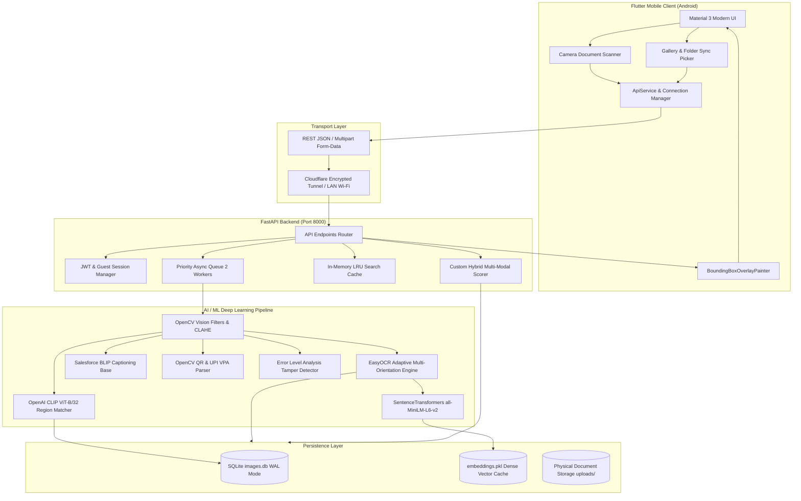
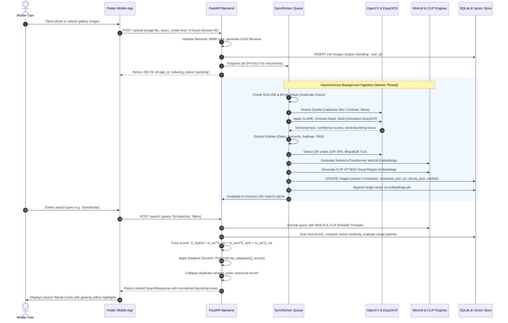

# DocuLens AI - SYSTEM ARCHITECTURE

## 7. Existing-System Overview

Traditional gallery systems (such as default Android Gallery, basic Google Photos search, or Apple Photos) exhibit fundamental limitations when managing document collections:
1. Reliance on Filenames and Date Timestamps: Standard mobile galleries index files by camera sequence (e.g. `IMG_20241021_120412.jpg`) or EXIF timestamps. Unless a user manually renames thousands of files, finding a document requires tedious chronological scrolling.
2. Black-Box Cloud OCR with Mandatory Cloud Sync: Commercial solutions (Google Lens, Adobe Scan) require uploading the user's private documents to public cloud servers. For sensitive personal documents (tax filings, medical records, ID cards), this presents privacy and compliance risks.
3. Keyword Fragility: Basic OCR search engines perform naive substring queries. A search for 'Doctor' will fail to match 'Physician' or 'MBBS Clinic' because they lack semantic vector representations.
4. Lack of Physical Localization: Existing gallery search tools indicate that an image matched a query, but they do not draw bounding boxes indicating where the text or object appears on the page.
5. Inability to Cross-Link Related Documents: Existing gallery apps cannot automatically discover that Document #14 (Admission Form) and Document #88 (Fee Receipt) belong to the same person sharing the same Roll Number.

---

## 8. Proposed-System Overview

DocuLens AI re-architects document search from the ground up:
1. Privacy-First Edge-Host Architecture: The user maintains complete control over their documents. Processing occurs locally on the user's own machine or private VPS container.
2. Dual-Pass Quality-Aware OCR Engine: Before OCR execution, the system evaluates blur variance, brightness, dynamic range, and skew. If the document is degraded, it dynamically applies gamma adjustment, CLAHE contrast equalization, unsharp masking, and perspective dewarping.
3. Multi-Orientation Consensus Voting: Evaluates 0°, 90° CW, 90° CCW, and 180° rotations, inverse-transforming all polygon coordinates back to the original full-size image canvas.
4. 6-Signal Mathematical Score Fusion: Unifies lexical exact matching, fuzzy edit distance, MiniLM dense cosine similarity, CLIP visual patch similarity, QR metadata exact matching, and BLIP captioning using an adaptive dynamic threshold.
5. Self-Verifying Tamper-Evident Security: Incorporates JPEG Error Level Analysis (ELA) to compute localized forgery variance scores and HMAC-SHA256 ZK-Steganography to embed cryptographic verification signatures directly into pixel Least Significant Bits (LSBs).

---

## 9. System Architecture

The DocuLens AI architecture is divided into three distinct operational layers:
1. Flutter Mobile Client (Presentation & Capture Layer)
2. FastAPI Backend Engine (Business Logic & Orchestration Layer)
3. AI/ML Deep Learning Pipeline & SQLite Database (Inference & Persistence Layer)

---

## 10. Component Responsibilities

Component Breakdown:
1. Flutter Mobile Frontend:
   - Captures high-resolution photos via Camera Scan Screen with real-time viewfinder framing.
   - Selects multiple gallery files or entire local folders via Gallery Import and Folder Sync screens.
   - Manages connection states with automatic fallback across LAN Wi-Fi IPs, localhost, and Cloudflare tunnels.
   - Renders glowing yellow rectangular highlights for matching OCR text and cyan boxes for visual objects using custom CustomPainter canvas mathematics.
   - Caches user credentials, JWT tokens, and unique client guest session UUIDs in SharedPreferences.

2. FastAPI Application Router (main.py):
   - Exposes REST endpoints for authentication, uploads, search, relationships, tampering analysis, and PDF export.
   - Enforces strict multi-tenant Row-Level Security (RLS) ensuring users only access their own uploaded files.
   - Houses an in-memory LRU cache storing the top 128 queries for sub-5 millisecond repeated search responses.
   - Operates a ThreadPoolExecutor running concurrent keyword, semantic, and visual search tasks.

3. Asynchronous Sync Worker (sync_worker.py):
   - Decouples HTTP file uploads from CPU-heavy AI model processing.
   - Implements a priority queue prioritizing identity cards and receipts (Priority 0) over bulk archive photos (Priority 1/2).
   - Manages a 2-worker daemon thread pool preventing laptop CPU/RAM saturation.
   - Incrementally appends new document embeddings into RAM and disk vector stores in under 1 millisecond.

4. SQLite Database Manager (database.py):
   - Maintains relational document metadata, OCR text, normalized bounding box JSON, entity JSON, and perceptual hashes.
   - Runs in Write-Ahead Logging (WAL) mode enabling high-concurrency non-blocking reads during background indexing.
   - Enforces user isolation checks across all select, update, and delete queries.

---

## 11. Data-Flow Diagrams

End-to-End Processing Workflow:

---

## 12. Frontend Architecture

The Flutter frontend (`mobile_app/lib`) follows a modern, modular component architecture:

Directory Structure:
- `main.dart`: Application entry point initializing Flutter bindings, reading persistent guest session UUIDs, and mounting AuthScreen.
- `screens/auth_screen.dart`: Multi-tenant login, registration, and guest mode gateway with direct server ping verification.
- `screens/main_shell.dart`: Scaffold shell hosting the persistent Material 3 BottomNavigationBar with 4 main tabs: Dashboard, Search, Vault, and Settings.
- `screens/dashboard_tab.dart`: High-level command center displaying quick category chips, live connection status, sync metrics, and recent document uploads.
- `screens/search_tab.dart`: Interactive search interface featuring instant query input, multi-attribute filter drawer (Date range, Document category, File format, Visual objects), and real-time result counters.
- `screens/vault_tab.dart`: Complete document grid with sorting, duplicate grouping badges, pull-to-refresh, and one-tap PDF export.
- `screens/camera_scan_screen.dart`: Custom camera capture interface with high-contrast document framing grid and instant upload trigger.
- `screens/gallery_import_screen.dart`: Multi-file picker with real-time thumbnail preview and batch upload progress.
- `screens/sync_folder_screen.dart`: Automated folder crawler comparing local device gallery files against backend sync-check hashes.
- `screens/document_detail_screen.dart`: Deep inspection screen displaying high-resolution zoomable image, full extracted text, detected entities, tamper status, and interactive visual bounding box overlays.
- `widgets/bounding_box_painter.dart`: CustomPainter rendering yellow text highlight boxes and cyan visual object rectangles.
- `services/api_service.dart`: Centralized HTTP networking client handling automatic IP discovery, JWT bearer headers, guest session IDs, and offline fallback.

---

## 13. Backend Architecture

The FastAPI backend (`backend/app`) is designed for high-concurrency, asynchronous performance:

Subpackage Taxonomy:
- `app/main.py`: Primary application entrypoint defining FastAPI routes, CORS middleware, LRU search cache, and thread pool executor.
- `app/auth.py`: Cryptographic authentication module implementing OAuth2 password bearer tokens, JWT encoding/decoding (HS256), and row-level tenant resolution.
- `app/database.py`: Direct SQLite access layer utilizing connection contexts, PRAGMA optimizations, and parameterized queries.
- `app/ocr/`: Modular OCR subsystem containing quality assessment (`quality.py`), image preprocessing (`preprocessing.py`), document perspective enhancement (`document_enhancer.py`), handwriting ink enhancement (`handwriting.py`), and the core adaptive multi-orientation engine (`ocr_engine.py`).
- `app/search/`: Lexical and metadata retrieval subsystem implementing exact keyword matching, tokenization, inflection matching (`exact_search.py`), fuzzy edit-distance matching (`fuzzy_search.py`), and metadata filtering (`metadata_search.py`).
- `app/semantic_search.py`: Dense vector retrieval engine managing SentenceTransformer models, cosine similarity computation, in-memory vector cache, and incremental embedding appending.
- `app/visual_search.py`: Vision-Language visual region retrieval engine managing OpenAI CLIP ViT-B/32 embeddings, prompt ensembling, and spatial patch scoring.
- `app/visual_detector.py`: OpenCV computer vision module detecting contours, color regions, and bounding proposals.
- `app/qr_decoder.py`: Advanced barcode and QR decoder parsing UPI payment VPAs, BharatQR TLV records, and vCards.
- `app/duplicates/`: Duplicate detection and clustering engine implementing SHA-256 hashing, 64-bit pHash, Hamming distance, and result collapsing.
- `app/entities/`: Document entity extraction engine parsing dates, amounts, phone numbers, emails, Aadhaar, and PAN numbers.
- `app/linking/`: Relational document linker discovering cross-document relationships based on shared high-confidence identifiers.
- `app/tamper_detector.py`: Error Level Analysis (ELA) JPEG compression artifact analyzer.
- `app/patentable/`: Cutting-edge security innovations: ZK-Steganography HMAC binding (`stego_crypto_binding.py`), localized spatial forgery detection (`forgery_localizer.py`), and Shannon query entropy fusion (`entropy_fusion.py`).
- `app/pdf_exporter.py`: Searchable PDF compiler utilizing ReportLab.

---

## 14. Database Schema and Relationships

DocuLens AI uses an embedded SQLite database (`database/images.db`) operating with Write-Ahead Logging (`PRAGMA journal_mode=WAL`).

Tables:
1. `images` Table (Primary Document Registry - 512 records in current database):
- `id` INTEGER PRIMARY KEY AUTOINCREMENT
- `image_name` TEXT NOT NULL (Unique storage filename with UUID suffix)
- `image_path` TEXT NOT NULL (Absolute disk path)
- `extracted_text` TEXT (Combined multiline OCR and extracted text)
- `original_ocr_text` TEXT (Raw baseline OCR text before cleanup)
- `cleaned_text` TEXT (Normalized text after whitespace and Devanagari digit mapping)
- `category` TEXT (Document classification: SCHOLARSHIP, EXAM, FEES, ADMISSION, etc.)
- `has_visual_objects` INTEGER DEFAULT 0 (Boolean flag: 1 if visual regions detected)
- `visual_metadata` TEXT (JSON serialized dictionary of detected visual regions)
- `entities_json` TEXT (JSON serialized dictionary of extracted structured entities)
- `file_size_bytes` INTEGER (File size in bytes)
- `image_width` INTEGER (Original image width in pixels)
- `image_height` INTEGER (Original image height in pixels)
- `file_format` TEXT (File format extension: .jpg, .png, .webp)
- `file_modified_at` TEXT (Filesystem last modified timestamp)
- `exif_created_at` TEXT (Original camera EXIF timestamp)
- `primary_date` TEXT (ISO YYYY-MM-DD extracted document date)
- `sha256_hash` TEXT (Cryptographic binary hash for exact duplicate detection)
- `phash` TEXT (64-bit hexadecimal perceptual hash for visual near-duplicate detection)
- `is_duplicate` INTEGER DEFAULT 0 (Boolean flag: 1 if duplicate of canonical document)
- `canonical_image_id` INTEGER (Foreign key pointing to primary canonical document id)
- `duplicate_similarity` REAL DEFAULT 0.0 (Similarity ratio: 1.0 for binary, 0.92-0.98 for pHash)
- `duplicate_match_type` TEXT ('exact_binary', 'exact_phash', 'near_duplicate', 'unique')
- `user_id` INTEGER DEFAULT 1 (Tenant ownership key: references users.id)
- `blip_caption` TEXT (Natural language visual caption generated by BLIP)
- `qr_payload` TEXT (Decoded QR / Barcode text payload or UPI payment VPA)
- `stego_payload` TEXT (Hidden LSB steganographic text payload)
- `ocr_boxes_json` TEXT (JSON list of word-level bounding boxes and confidence scores)
- `indexing_status` TEXT DEFAULT 'completed' ('pending', 'indexing', 'completed', 'failed')
- `is_demo` INTEGER DEFAULT 0 (Boolean flag: 1 for demo sample documents)
- `is_quarantined` INTEGER DEFAULT 0 (Boolean flag: 1 if quarantined for security/privacy)
- `created_at` TIMESTAMP DEFAULT CURRENT_TIMESTAMP

2. `visual_regions` Table (Spatial Visual Patches - 1,286 records):
- `id` INTEGER PRIMARY KEY AUTOINCREMENT
- `image_id` INTEGER (Foreign key referencing images.id)
- `image_name` TEXT (Filename of parent document)
- `region_source` TEXT ('color_region', 'contour_graphic', 'qr_detector', 'card_proposal', 'full_doc')
- `location_desc` TEXT ('Top-Left', 'Bottom-Right', 'Center', etc.)
- `bbox_json` TEXT (Pixel bounding box: {x, y, width, height})
- `norm_bbox_json` TEXT (Normalized relative bounding box: {x, y, width, height})
- `embedding_blob` BLOB (Raw 512-dimensional float32 binary vector generated by CLIP ViT-B/32)
- `created_at` TIMESTAMP DEFAULT CURRENT_TIMESTAMP

3. `image_relationships` Table (Cross-Document Knowledge Links):
- `id` INTEGER PRIMARY KEY AUTOINCREMENT
- `source_image_id` INTEGER (Foreign key referencing images.id)
- `target_image_id` INTEGER (Foreign key referencing images.id)
- `relationship_type` TEXT ('shared_aadhaar', 'shared_pan', 'shared_application_id', 'shared_phone')
- `confidence_score` REAL DEFAULT 1.0 (Link confidence score)
- `evidence` TEXT (Extracted shared token e.g. 'ABCDE1234F')
- `created_at` TIMESTAMP DEFAULT CURRENT_TIMESTAMP

4. `users` Table (User Accounts & Authentication - 118 records):
- `id` INTEGER PRIMARY KEY AUTOINCREMENT
- `username` TEXT UNIQUE NOT NULL
- `hashed_password` TEXT NOT NULL (Bcrypt salted hash)
- `is_admin` INTEGER DEFAULT 0 (Boolean flag: 1 for administrator accounts)
- `created_at` TIMESTAMP DEFAULT CURRENT_TIMESTAMP

---

